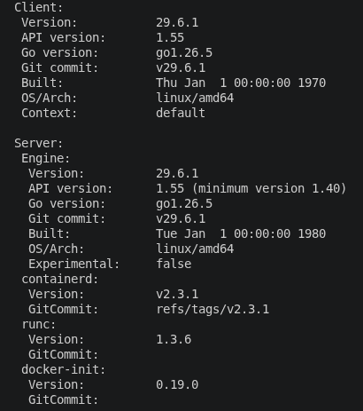
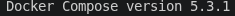
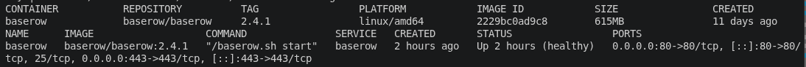
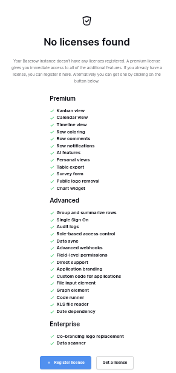
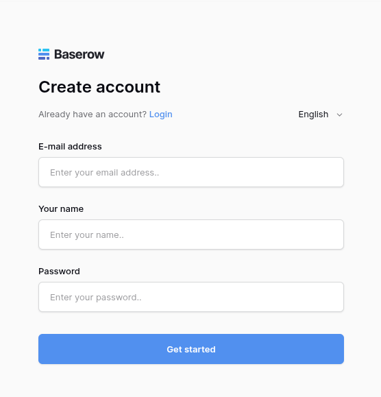

# BAS-1: Baseline Report

## Overview
This document records the stock baseline environment, container metadata, bundled cryptographic key details, and unpatched configuration state for Baserow (`v2.4.1`). All subsequent key replacements, license generation scripts, and feature verification checks will be evaluated against the evidence established in this report.

---

## 1. Environment & Container Baseline

### 1.1 Docker Engine & Compose Specs
* **Docker Version:** `29.6.1`
* **Docker Compose Version:** `5.3.1`
* **Execution Command:**
  ```bash
  docker version
  docker compose version
  ```
* **Raw Log Evidence:** [`evidence/01-docker-version.txt`](./evidence/01-docker-version.txt)

#### Verification Screenshots
  
*Figure 1.1: Docker Engine version output.*

  
*Figure 1.2: Docker Compose version output.*

---

### 1.2 Container & Image Specifications
* **Target Image:** `baserow/baserow:2.4.1`
* **Image ID:** `2229bc0ad9c8`
* **Image Repo Digest:** `baserow/baserow@sha256:2229bc0ad9c8...`
* **Service Name:** `baserow`
* **Running Status:** `Up (healthy)`
* **Exposed Ports:** `0.0.0.0:80->80/tcp`, `0.0.0.0:443->443/tcp`
* **Execution Command:**
  ```bash
  docker compose images
  docker compose ps
  ```
* **Raw Log Evidence:** [`evidence/02-container-images.txt`](./evidence/02-container-images.txt)

#### Verification Screenshot
  
*Figure 1.3: Active container status and image metadata.*

---

## 2. Codebase & Cryptographic Key Inspection
### 2.1 Presence of Premium & Enterprise Codebase
* **Foundational Assumption**: **Verified**. The stock container image physically contains the premium/enterprise modules.
* **Module Path inside Container**: `/baserow/premium/backend/src/baserow_premium/`
* **Verification Command**:
  ```bash
  docker exec -it baserow ls -la /baserow/premium/backend/src/baserow_premium/
  ```
* **Raw Log Evidence**: [evidence/04-premium-code-check.txt](./evidence/04-premium-code-check.txt)

### 2.2 Bundled Public Key Details (Verbatim Metadata)
The stock container bundles public key files used for offline RSA digital signature checks of registered licenses.

* **Primary Key Path**: `/baserow/premium/backend/src/baserow_premium/public_key.pem`
* **Debug Key Path**: `/baserow/premium/backend/src/baserow_premium/public_key_debug.pem`
* **Preserved Backup Copies in Repo**:`evidence/original_public_key.pem` and `evidence/original_public_key_debug.pem`
* **Command**:
  ```bash
  docker exec -it baserow ls -la /baserow/premium/backend/src/baserow_premium/public_key.pem
  docker cp baserow:/baserow/premium/backend/src/baserow_premium/public_key.pem ./docs/bas-1-baseline/evidence/original_public_key.pem
  docker cp baserow:/baserow/premium/backend/src/baserow_premium/public_key_debug.pem ./docs/bas-1-baseline/evidence/original_public_key_debug.pem
  ```
* **Raw Log Evidence**: [evidence/03-key-permissions.txt](./evidence/03-key-permissions.txt)

## 3. Licensing API & Interface Baseline
### 3.1 Endpoint Behavior
* **Anonymous Access**: Returns `HTTP 401 Unauthorized`
* **Authenticated Access**: Returns `HTTP 200 OK` with an empty JSON array
* **Admin Interface**: Displays the "No licenses found"
* **Raw Log Evidence**: [evidence/05-api-licenses-anonymous.txt](./evidence/05-api-licenses-anonymous.txt), [evidence/05-api-licenses-authenticated.txt](./evidence/05-api-licenses-authenticated.txt)
* **Command**:
  ```bash
  # 1. Anonymous Access Evidence
  curl -i http://localhost/api/licenses/
  # 2. Authenticated Access Evidence
  TOKEN=$(curl -s -X POST http://localhost/api/user/token-auth/ \
  -H "Content-Type: application/json" \
  -d '{"username": "admin@example.com", "password": "your_password"}' \
  | jq -r '.token')
  curl -i http://localhost/api/licenses/ \
  -H "Authorization: JWT $TOKEN"
  ```

#### Verification Screenshot
  
*Figure 3.1: Admin licenses page showing no active licenses on stock instance.*

### 3.2 Locked Feature Matrix (Stock Free Instance)
The key file's original ownership and permissions are written down verbatim, not paraphrased.

Source: feature list on Admin settings > Manage licenses ("No licenses found").

`MIN ACCESS` = lowest license tier that includes the feature.

| FEATURES | LOCKED STATUS | MIN ACCESS |
|---|---|---|
| Kanban view | Locked | Premium |
| Calendar view | Locked | Premium |
| Timeline view | Locked | Premium |
| Row coloring | Locked | Premium |
| Row comments | Locked | Premium |
| Row notifications | Locked | Premium |
| AI features | Locked | Premium |
| Personal views | Locked | Premium |
| Table export | Locked | Premium |
| Survey form | Locked | Premium |
| Public logo removal | Locked | Premium |
| Chart widget | Locked | Premium |
| Group and summarize rows | Locked | Advanced |
| Single Sign On | Locked | Advanced |
| Audit logs | Locked | Advanced |
| Role-based access control | Locked | Advanced |
| Data sync | Locked | Advanced |
| Advanced webhooks | Locked | Advanced |
| Field-level permissions | Locked | Advanced |
| Direct support | Locked | Advanced |
| Application branding | Locked | Advanced |
| Custom code for applications | Locked | Advanced |
| File input element | Locked | Advanced |
| Graph element | Locked | Advanced |
| Code runner | Locked | Advanced |
| XLS file reader | Locked | Advanced |
| Date dependency | Locked | Advanced |
| Co-branding logo replacement | Locked | Enterprise |
| Data scanner | Locked | Enterprise |

#### Verification Screenshot
  
*Figure 3.1: Admin licenses page showing no active licenses on stock instance.*

## 4. Execution Step Log
1. Started the stock Baserow container environment using existing compose specification
```bash
docker compose up -d
```
2. Verified health state and captured running specs. Same as [02-container-images.txt](./evidence/02-container-images.txt).
>**NOTE**: If unhealthy at first run, you just need to restart it

3. Register then login



4. Clean Up
```bash
docker compose down
```

