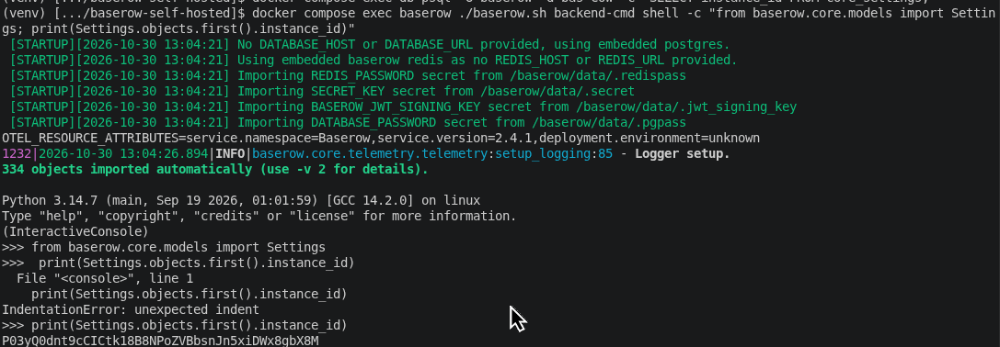

# BAS-2: Generate Key Pair and Self Signed
*CODE:DEV-886*

## Overview
Produce the two artifacts the patch needs: a public key to place into the container, and a signed license blob to register. This is self-contained cryptographic work with no Baserow dependency, so it can be built and tested in isolation before any container is touched.

## Why?
1. Why PSS? To create different signature result
2. Why SHA-256? To lock and hide our real data because SHA can't be decrypt

## Step by Step
1. Get Instance ID (For Now)

Because we don't create a database container, we can use this command bellow to access our Instance ID
- Command:
```bash
# you have to run docker compose first
docker compose exec baserow ./baserow.sh backend-cmd shell

# use this after entering python shell
from baserow.core.models import Settings
print(Settings.objects.first().instance_id)
```
- Expected : Got Instance ID
- Evidence : 



2. Create Public and Private PEM

This documentation has included script to make it. Just run follow this command

- Command:
```bash
python create_pem.py
```
- Expected: Create a private and public pem. The private one is excluded from repo

3. Generate License

It's also been covered in script
- Command:
```bash
python create_licence.py
```
- Expected: Create a license (`license_token.txt`). This file is also excluded from repo

4. Verify Lincense

Has been covered in script
>**NOTE**: There's comment in this file that explain standard RSA failed
- Command:
```bash
python verify.py
```
- Expected: Get `SUCCESS` and `FAILED` result test. `SUCCESS` for the generated license. `FAILED` for the tampered one

### Action Screenshots
1. Create pem


2. Create license


3. Verify


## Struggles While Develops
1. Can't use AI directly
>**SOLUTION**: Don't ask directly to bypass but ask how the `JWT` and `Baserow` license work. If don't know how to create cryptography, then check documentation in the internet or ask AI again
2. Wrong decrypt process
>It's when create `create_license.py` script. Forget that the payload we sent in license is text version
```py
payload_b64 = base64.urlsafe_b64encode(json_string.encode())
pre_hashed = hashlib.sha256(payload_b64).hexdigest().encode()

signature = private_key.sign(
    pre_hashed,
    padding.PSS(
        padding.MGF1(hashes.SHA256()),
        padding.PSS.MAX_LENGTH
    ),
    hashes.SHA256()
)
```
>**SOLUTION**:
```py
payload_b64 = base64.urlsafe_b64encode(json_string.encode()).rstrip(b"=")
pre_hashed = hashlib.sha256(payload_b64).hexdigest().encode()

signature = private_key.sign(
    pre_hashed,
    padding.PSS(
        padding.MGF1(hashes.SHA256()),
        padding.PSS.MAX_LENGTH
    ),
    hashes.SHA256()
)
sig_b64 = base64.urlsafe_b64encode(signature).rstrip(b"=").decode()
```
