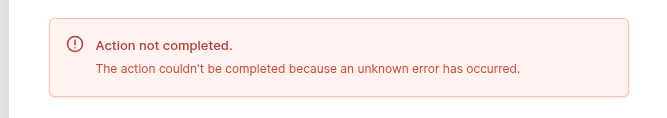
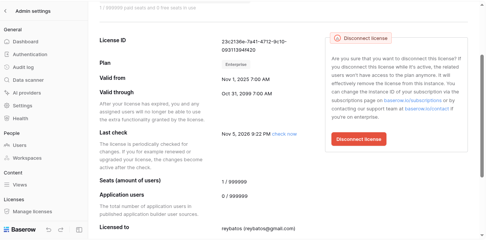
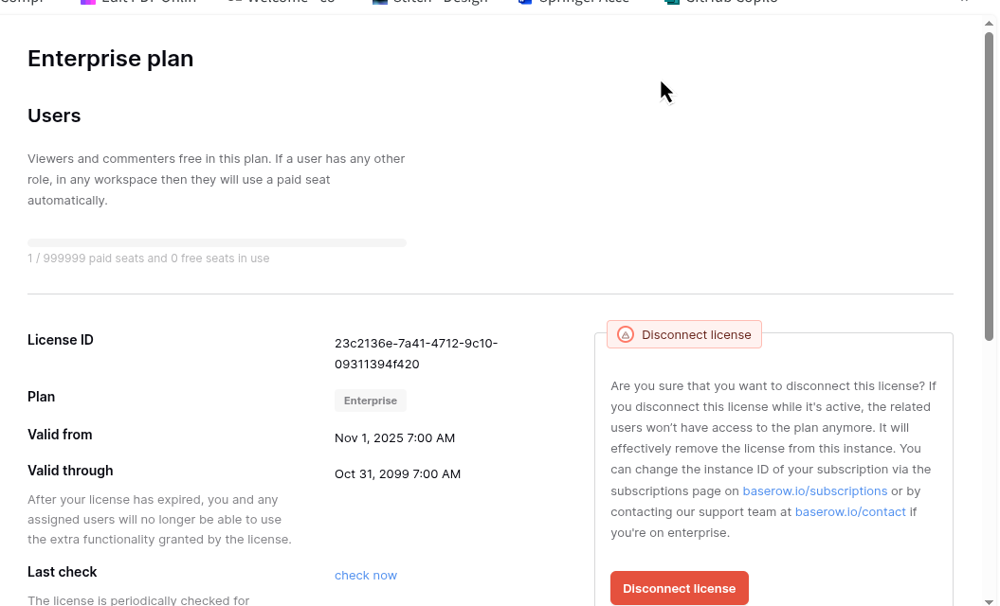
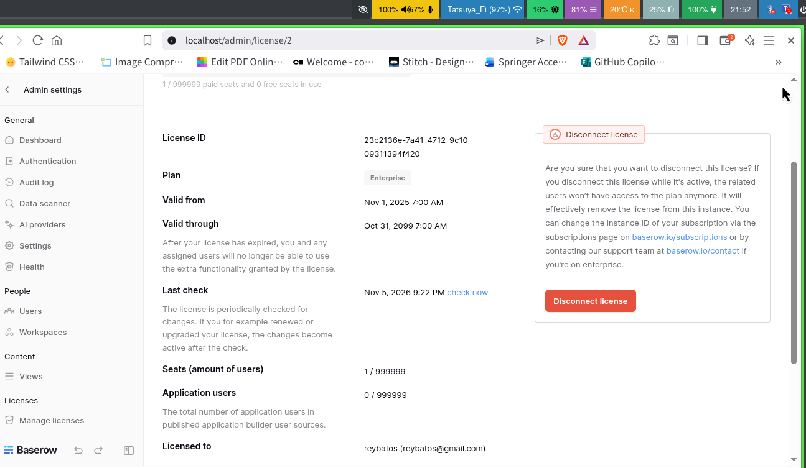
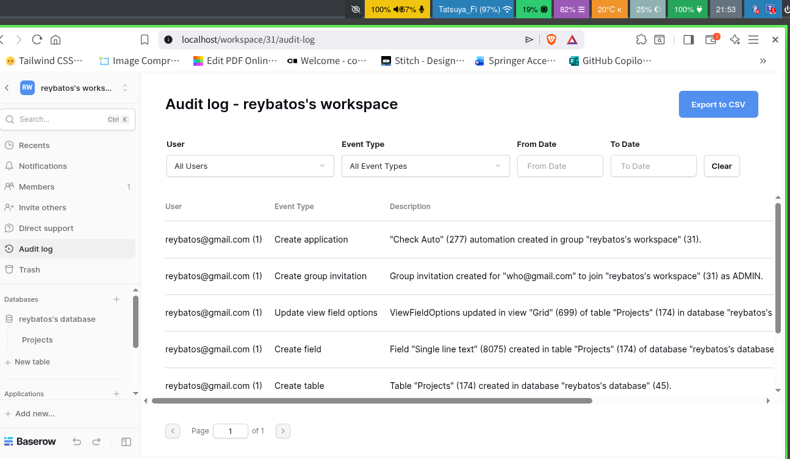
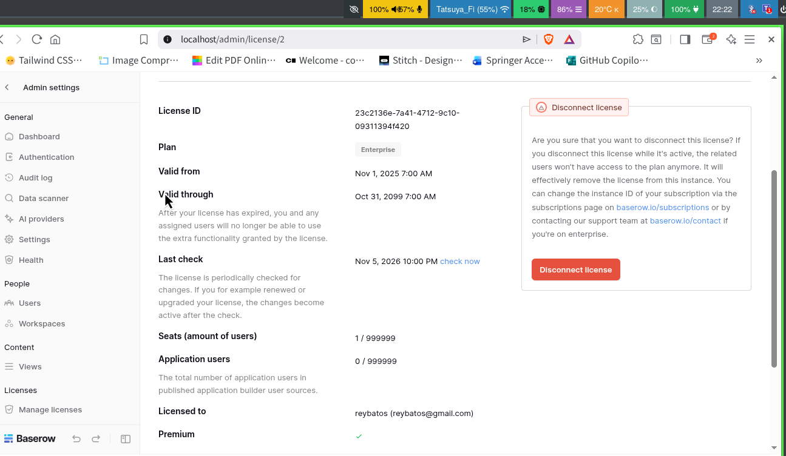
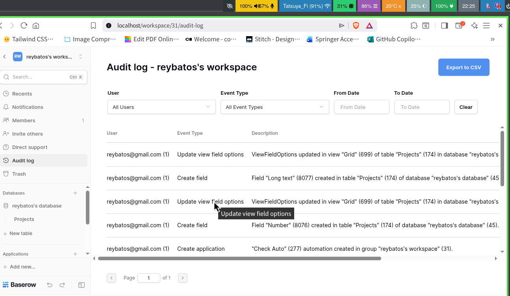
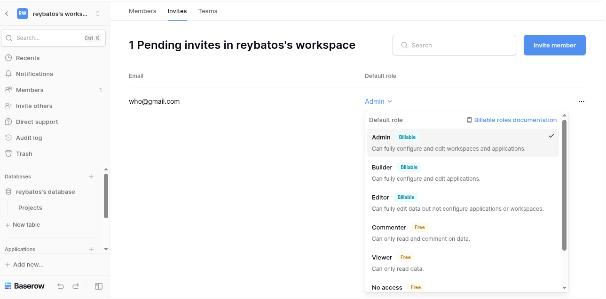
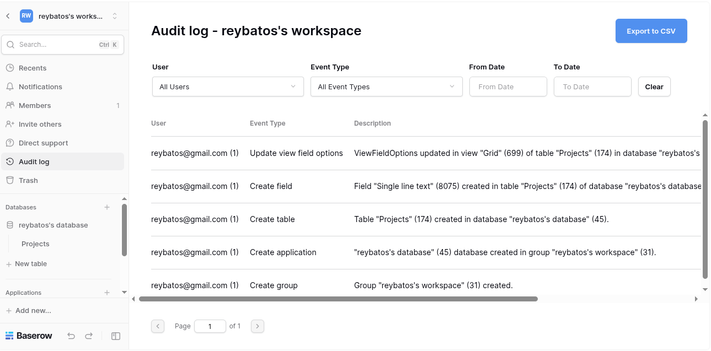

# BAS-3: Determine the full set of network dependencies and the failure mode

> DEV-887

This repository documents the environment setup, licensing architecture verification, role-based access control (RBAC), audit logging, and empiric log analysis for self-hosted Baserow Enterprise (Version 2.4.1).

## 1. Self-Hosted Licensing & Verification Workflow

### 1.1. Active License Status

Upon valid payload validation and signature checks, the self-hosted Enterprise license is successfully applied and marked as `Active`.

* **License Details:**
  * **License Type:** Enterprise Self-Hosted
  * **Status:** Active

### 1.2. Time-Bound Expiration Verification

Testing was conducted with varying temporary token lifetimes to verify authority polling and license revocation handling:

* **30-Minute Validity Window:** Verified license recognition and feature unlock for a short duration window.

* **60-Minute Validity Window:** Extended time window test to confirm stable license retention across worker heartbeats.

#### Deliverable Findings & Resolution
- **License Evaluation Mechanism:** Self-hosted Enterprise features operate via automatic JWT signature verification against the internal public key (`public_key.pem`). The instance auto-detects and validates license status directly during runtime without relying on a local license cache TTL.
- **Probe Interval & Heartbeat:** Because license status is evaluated continuously via background routines rather than held in a temporary cache, probe intervals for BAS-9 should align directly with Celery Beat periodic task schedules aprocimately 45-60 minutes after register.
- **Network Independence & Local Service Requirement:** Offline/Air-gapped operation is fully supported. External authority polling to `api.baserow.io` is not required, and **no local proxy/mock service needs to be deployed** because payload validation relies solely on local cryptographic verification.
- **Revocation Behavior:** Upon expiration of the token window without a valid signed update, the instance automatically degrades to the Community/Free tier, revoking access to Enterprise RBAC and Audit Logs gracefully without system downtime or crashes.
- **Re-evaluation Triggers:** No secondary triggers (such as user creation or manual workspace refreshes) force a license re-evaluation; authority status relies strictly on background time-window checking.
---

## 2. Enterprise Feature Validation

### 2.1. Advanced Role-Based Access Control (RBAC)

Verified custom role assignments and granular access permissions per workspace/table level.

* **Default Roles Synced:** 9 default roles synced during DB migration.

* **Role Permissions:** Custom workspace roles successfully assigned and active.

### 2.2. Enterprise Audit Logs

Verified tracking of system events, user actions, and administrative operations.

* **Log Retention & Tasks:** `clean_up_audit_log_entries` executed cleanly via Celery Beat.

* **Audit Dashboard:** Active event records logged with user context and timestamps.

---

## 3. Log Analysis & Startup Verification

Below is the empiric breakdown based on the container runtime logs (`./evidence/authority_offline_empiric.log`):

### 3.1. Startup Sequence

1. **Service Initialization:** Embedded PostgreSQL 15.19 and Redis 8.10.2 started under Supervisord.
2. **Reverse Proxy:** Caddy initialized listening on HTTP port 80.
3. **Database Migrations:** Applied core, enterprise, premium, and builder migrations (`locked_migrate`).
4. **Template Synchronization:** Synced 158 default Baserow templates asynchronously via Celery export worker.
5. **Background Scheduler:** Celery Beat initialized (`RedBeatScheduler`) and scheduled periodic tasks.

---

## 4. Known Errors & Troubleshooting Notes

> **Note:** The errors listed below were intentional or configuration-specific test anomalies to be documented for troubleshooting and testing purposes.

### 4.1. Invalid License

* **Problem:**
  

* **Reason:** Base64 header was removed from the payload. Check the `handler.py` function `decode_license()` from line 196

* **Solution:** Do not remove the Base64 header from the payload.

### 4.2. PostgreSQL `pgvector` Extension Warning

* **Log Entry:** `ERROR: permission denied to create extension "vector"` / `Must be superuser to create this extension`

* **Impact:** Assistant knowledge base sync was skipped due to missing vector extension permissions but it's not a big deal because you may still use baserow like usual

* **Resolution:** Ensure the database user has superuser privileges or manually pre-install the `vector` extension in PostgreSQL prior to running migrations.

### 4.3. Public URL Warning

* **Log Entry:** `WARNING: Baserow is configured to use a BASEROW_PUBLIC_URL of http://localhost:80`

* **Resolution:** Set `BASEROW_PUBLIC_URL` to the intended FQDN when deploying outside localhost.

---

## 5. Screenshots & Visual Proofs

| Feature / Verification | Reference Image | 
| ----- | ----- | 
| **Initial Check** |  | 
| **Active License** |  | 
| **30-Min License Check** |  | 
| **30-Min Feature Check** |  | 
| **60-Min License Check** |  | 
| **60-Min Feature Check** |  | 
| **RBAC / Role Management** |  | 
| **Audit Logs** |  | 
| **Error Screen** |  | 