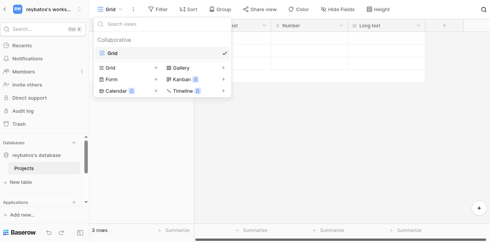
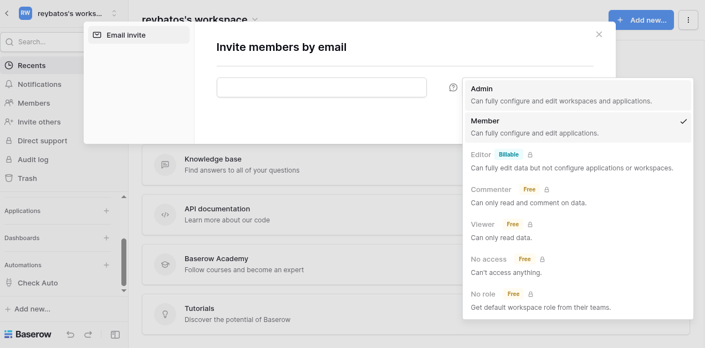
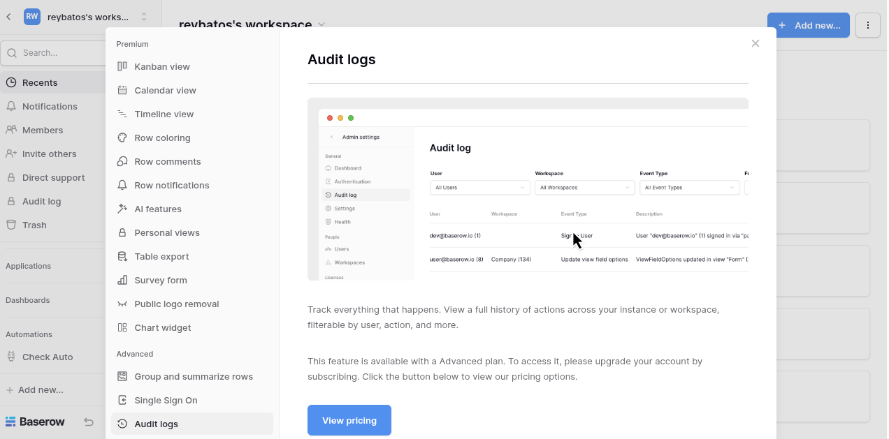
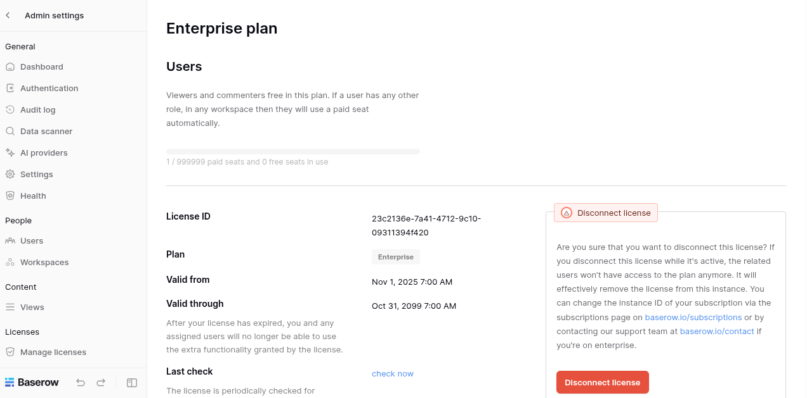
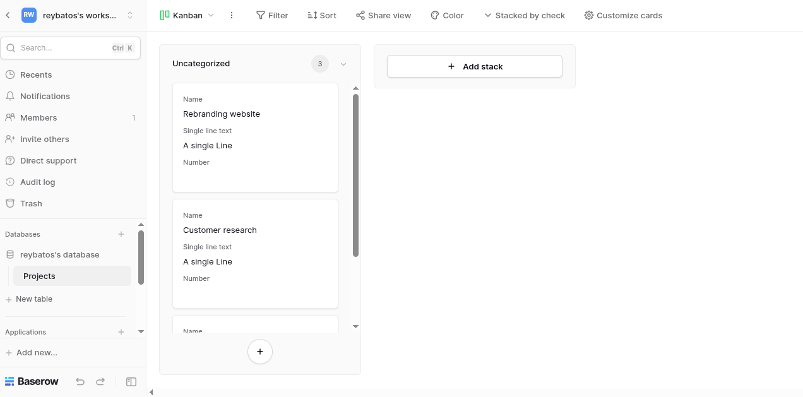
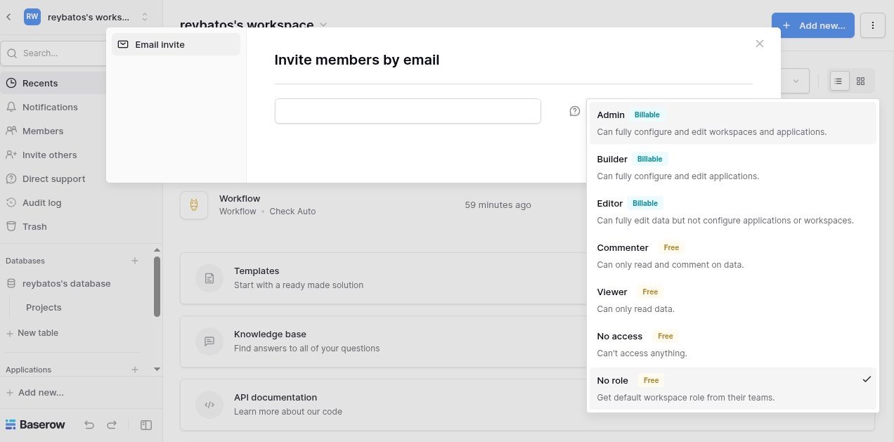
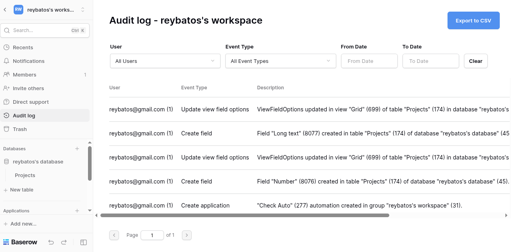
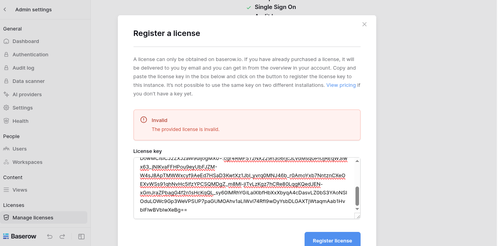

# BAS-4: Make the patch work on the current version and get a license to register
*CODE:DEV-888*

This sub task is almost identical with DEV-886 but in this task we focusing on create dynamic generate license, also shows the differences between using base `public.pem` and mounted `public.pem`

## Locked Features
1. View Modes



2. RBAC



3. Audit Logs



## License Register

### Mounted `public.pem`
1. Register Result

Result : SUCCESS



2. Active Features
    * View Modes

    

    * RBAC

    

    * Audit Logs

    

### Using Base `public.pem`
1. Register Result

Result : INVALID



2. Still Register but Changed

Result : ERROR


>**DESCRIPTION**: It's because we have activate license but we changed its `public.pem`

## Step by Steps
1. Generate PEM
- Command:
```bash
python create_pem.py
```
- Expected: `private.pem` and `public.pem` created

2. Run services
- Command:
```bash
docker compose up -d
```
- Expected : `baserow` service run and healthy

3. Generate license
- Command:
```bash
python create_license.py
```
- Expected : `licene_token.txt` created with dynamically payload

4. License register
- Screenshots:


- Expected : Successfully become `enterprise`

