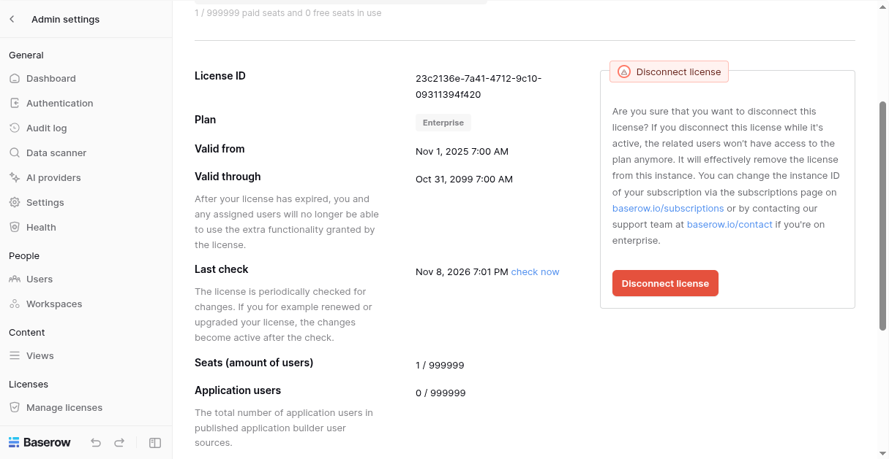
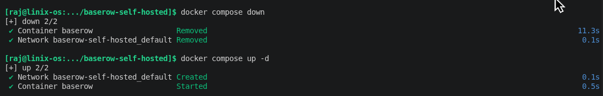
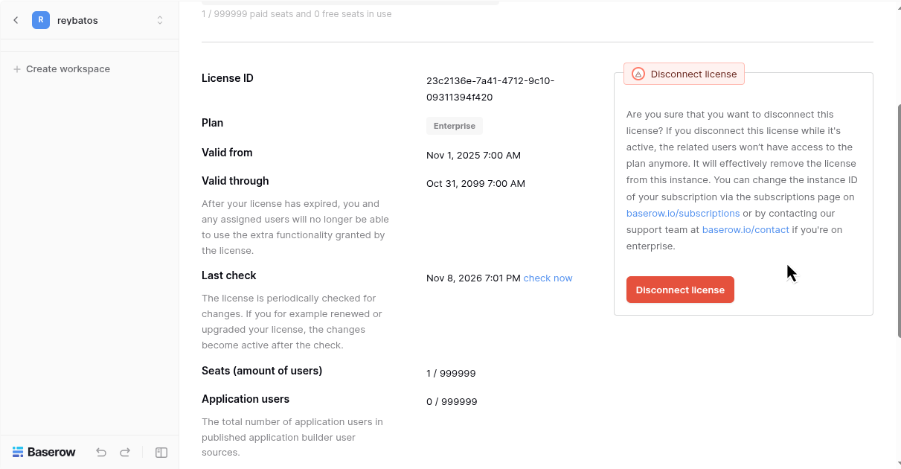
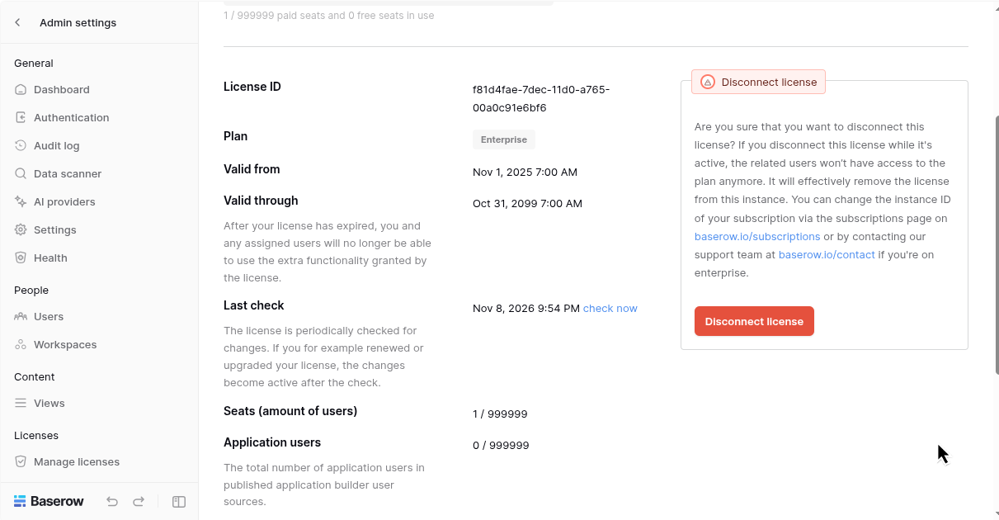
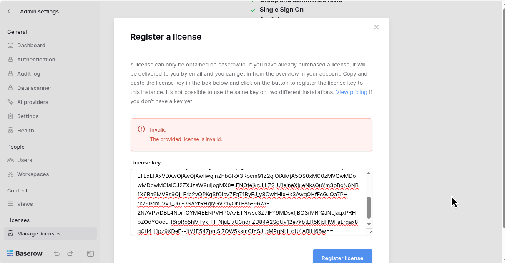

# BAS-5: Make the patch survive container recreation, not just a restart
*CODE:DEV-889*

This ticket addresses transforming the license verification key patch from a temporary runtime action into a permanent, declarative deployment setup. The patch must automatically survive container recreations (attributable to host reboots, compose updates, image refreshes, or shutdowns) without requiring any manual intervention during runtime.

---

## 2. Technical Evaluation of Approaches

To satisfy declarative deployment requirements while adhering to the standalone architecture constraint (BAS-7), three approaches were evaluated:

### Option 1: Bind Mount (`./public.pem`) — **CHOSEN**
* **Mechanism:** Direct binding of `./public.pem` from the host system to the internal public key paths inside the container (`public_key.pem` and `public_key_debug.pem`) using standard Docker Compose `volumes`.
* **Justification:**
  1. **Simplicity & Speed:** Configured entirely within `docker-compose.yml` without introducing extra build steps, base image alterations, or entrypoint wrappers.
  2. **Direct Host-Container Connection:** Creates a real-time link between the host file and the container file. If container startup routines attempt to overwrite or alter the file, changes are reflected directly on the host device making any tampering immediately visible and traceable.
  3. **Zero Manual Steps:** Replaces temporary commands (`docker cp`) with automatic infrastructure-level provisioning upon container initialization.
* **Anti-Clobber Verification:** Checksum analysis (`sha256sum`) confirms that Baserow 2.4.1's internal startup script does not modify or overwrite mounted files.

---

### Option 2: Wrapper Script Entrypoint — **REJECTED**
* **Mechanism:** Executing an intermediate shell script prior to launching the main Baserow Django process to overwrite key files at boot time.
* **Reasons for Rejection:**
  1. **Overly External & High Runtime Risk:** Introduces an unmanaged execution layer outside official application scripts, raising failure risks during startup.
  2. **Permission Constraints:** Baserow runs under a non-root internal user (`baserow`). A wrapper script risks permission denied errors when modifying application paths and can break if upstream entrypoints change in future releases.
  3. **Unnecessary Overhead:** Requires overriding default container entrypoints/commands without adding functional benefit over bind mounting.

---

### Option 3: Custom / Derived Image — **REJECTED**
* **Mechanism:** Building a derived Docker image (`FROM baserow/baserow:2.4.1`) with the custom key embedded during the build layer.
* **Reasons for Rejection:**
  1. **Rebuild Overhead:** Significantly reduces flexibility for simple key adjustments, requiring a full image rebuild whenever a key update or minor change is introduced.
  2. **Violates Unmodified Official Image Objective:** Defeats the primary goal of keeping deployment reliant on unmodified official release images directly from Docker Hub.

---

## 3. Implementation Details

Final configuration applied to `docker-compose.yml`:

```yaml
services:
  baserow:
    container_name: baserow
    image: baserow/baserow:2.4.1
    environment:
      BASEROW_PUBLIC_URL: "http://localhost:80"
    ports:
      - "80:80"
      - "443:443"
    volumes:
      - baserow_data:/baserow/data
      - ./public.pem:/baserow/premium/backend/src/baserow_premium/public_key.pem
      - ./public.pem:/baserow/premium/backend/src/baserow_premium/public_key_debug.pem
    extra_hosts:  
      - "api.baserow.io:172.17.0.1"  

volumes:
  baserow_data:
```

---

## 4. Acceptance Criteria Verification

### AC-1: Lifecycle Persistence (Down & Back Up)
* **Status:** **PASS**
* **Verification:** 







### AC-2: Checksum Anti-Clobber Verification
* **Status:** **PASS**
* **Verification:** Host `sha256sum ./public.pem` perfectly matches the container's `sha256sum` post-startup, confirming the startup process leaves mounted keys intact.
* **Evidence:** [Checker Result](./evidence/checker-result.txt)
* **Command to verify:**
```bash
. pemcheck.sh
```
>NOTE: You should give execute permission before run using `chmod +x pemcheck.sh`

### AC-3: Standalone Requirement (BAS-7 Compatibility)
* **Status:** **PASS**
* **Verification:** Solved strictly within the existing single-container service specification. No helper containers, sidecars, or auxiliary services were introduced.

### AC-4: Disaster Recovery (Volume Wiped Test)
* **Status:** **PASS**
* **Observations (`docker compose down -v`):**
  - **Survives (Automated):** Key mount (`public.pem`) remains intact inside newly generated containers.
  - **Requires Intervention:** PostgreSQL database tables are cleared. License tokens must be re-submitted once via the UI/API, which registers instantly without requiring backend restarts because the key patch persists.
* **Evidence:** [Volume Down](./evidence/volume_wipe_test.txt), [Recovery](./evidence/volume_recover.txt)
* **Step by Step:** 
    * Remove and run services
    ```bash
    docker compose down -v && docker compose up -d
    ```
    * Create new license
    ```bash
    python create_license.py
    ```
    * Register it in setting page
    
>NOTE: The license must be generated again using `python create_license.py` because the instance will be different



## Findings
1. Create License becomes Invalid
* Reason : Accidentally using `python create_pem.py` but change `public.pem` to the old ones
* Solution : Create anothe pem, then it will be resolved