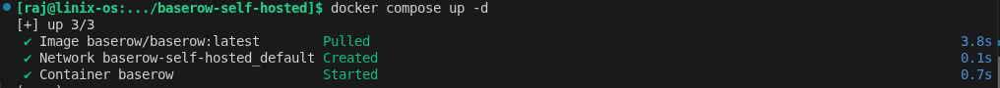
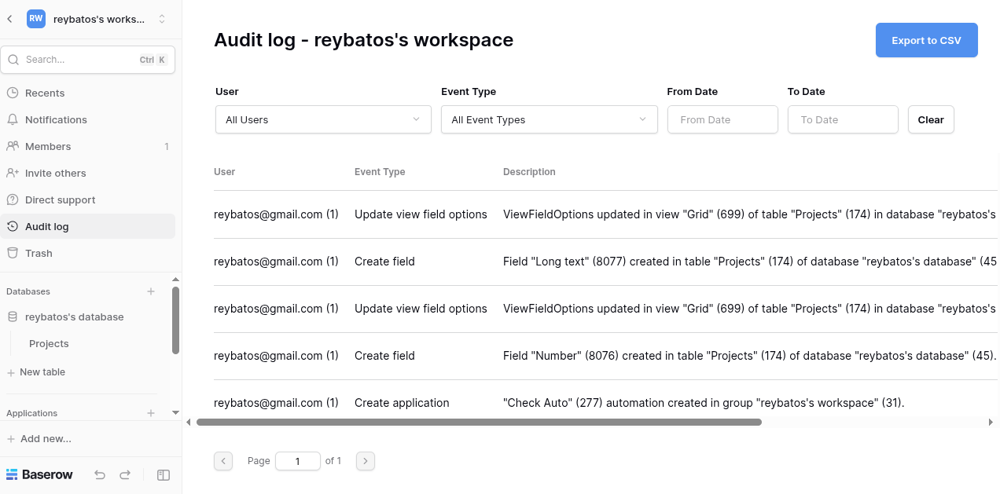
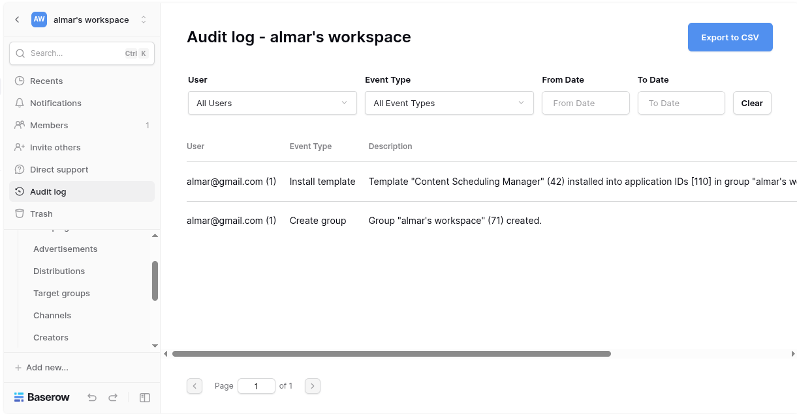
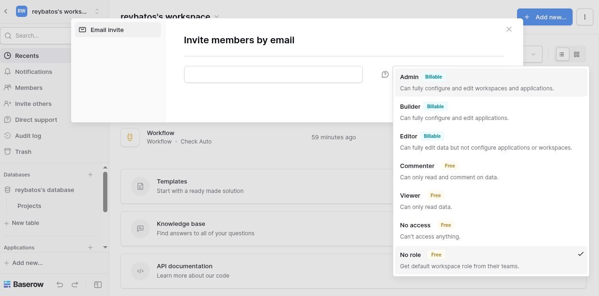
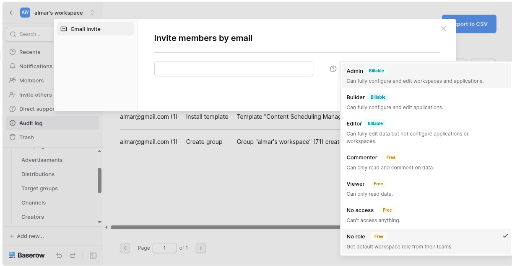
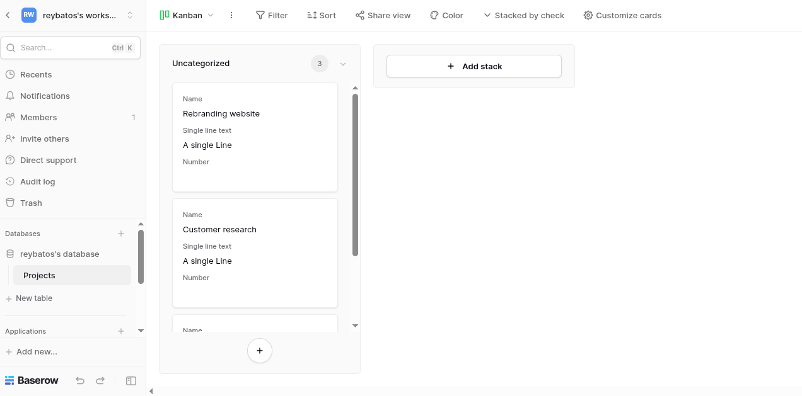
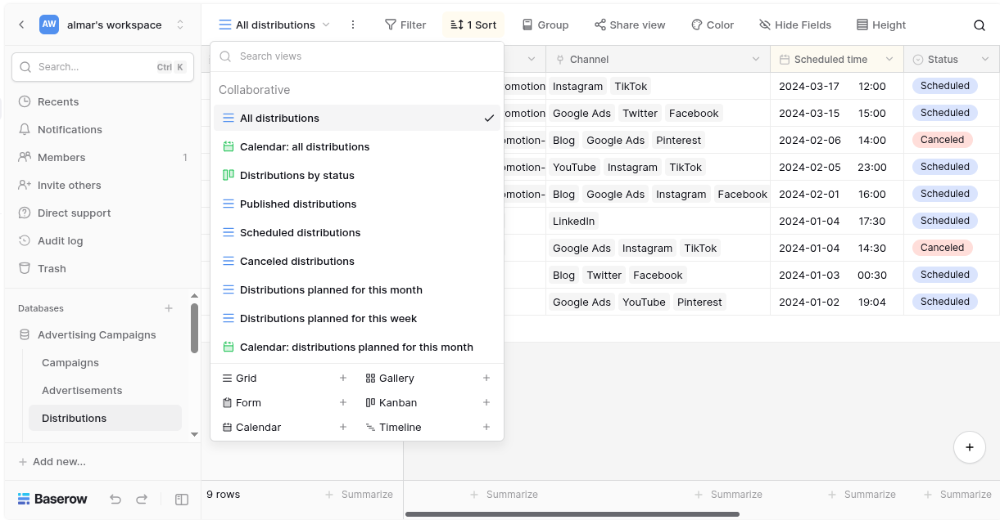
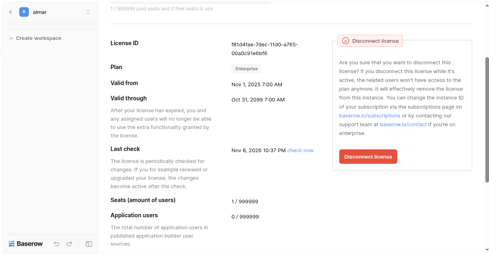

# BAS-6: Upgrade to the latest release, re-apply the patch, and verify
*CODE:DEV-889*

For this, we will focus on upgrading to the newest version baserow to check if it's still work or not

>**NOTE**: Actually, while documenting it, the current latest stable tag version is 2.4.1. So it's been checked since the begining. This will focus using `baserow/baserow:latest` to verify again

## Step by Step

### Down Services
First, you have to make sure the services is down completely
- Command :
```bash
docker compose down
```
- Expected : All service deactivate
>NOTE: Don't have to use `-v` because our goal just to make sure the license still running

### Recover Services
- Command :
```bash
docker compose up -d
```

- Expected : Pull new image latest version
- Screenshots :


### Key Check Before and After
- Command :
```bash
. pemcheck
```

- Expected : The Same Result Before and After
- Evidence : [New Check Result](./evidence/pemcheck-result.txt), [Old Check Result](../bas-5/evidence/checker-result.txt), [New Permissions](./evidence/premium-feature.txt), [Old Permission](../bas-1-baseline/evidence/04-premium-code-check.txt)

### Feature Before After
The features that active before and after rebuild
| FEATURE | BEFORE | AFTER |
| --- | --- | --- |
| Audit Log |  | 
| Member RBAC |  | 
| View Mode |  | 

### Reregister (Shouldn't Have to)
>**NOTE**: You don't have to reregister if you don't use `-v` while shutdown services.

#### Step by Step
If you use `-v` while downing then follow this step
1. Register in baserow
2. Update .env `BASEROW_LICENSE_EMAIL` and `BASEROW_LICENSE_NAME` according to your register account
3. Generate license
- Command:
```bash
python create_license.py
```
- Expected: Create a new license
4. Register the new license

#### What Should Happen
The license should be still valid like this image



## CI/CD
1. Allow Permission
```bash
chmod +x check-downtime.sh
chmod +x safe-recreate.sh
```
2. Checking Downtime
```bash
. check-downtime.sh
```
3. Safe Recreate
```bash
. safe-recreate.sh
```