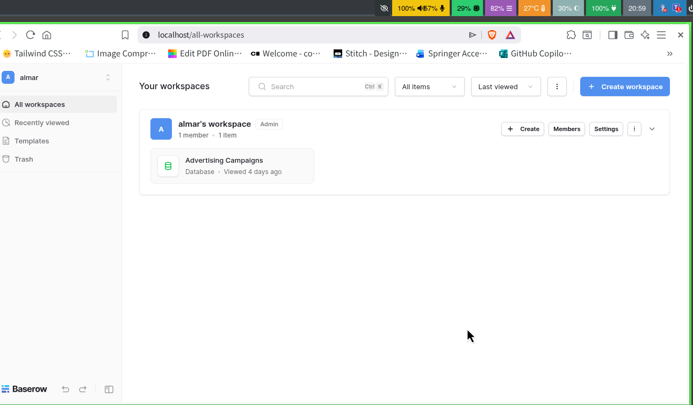
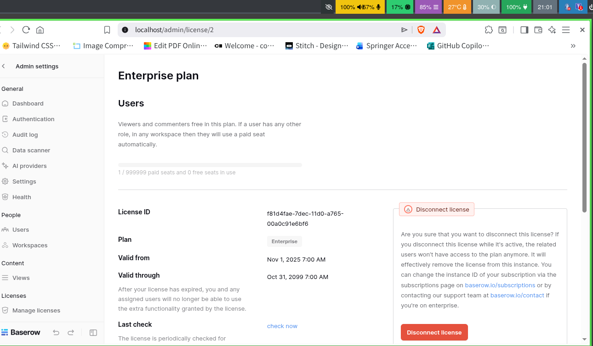

# BAS-7: Eliminate the external license-service dependency entirely
*CODE:DEV-891*

As the name of its title, this readme will contains things that we should be eliminate before jumping to the next step

>**NOTE**: Some of it may have been done inthe previous sub tasks. Now, we will just mention again to make sure same environment set up

## The Setup
### Only Official Deployment
What we meant with "Official Deployment" is that we don't create any unnecessary services and only focue on the baserow service. For example, you may read the `docker-compose.yml` file that has been created from the first time.

```yml
services:
  baserow:
#   rest of the settings
```

As you can see, there's only 1 service. Also, there's no any storage services here (Actually, its already included in the baserow service). [See File](../../docker-compose.yml)

### The Authority Host
We have done it at the very first step. Even, it's been stated in the ticket to handle it. The main goal of it is to make sure the license doesn't reach its public API

```yml
services:
  baserow:
#   rest of the settings
    extra_hosts:  
    - "api.baserow.io:172.17.0.1"

#   rest of the settings
```

With this `extra_hosts` setting, the license will only reach `localhost`

### License Checker
We have testing it on the previous [sub task](../bas-3/readme.md#1-self-hosted-licensing--verification-workflow). Here we will only stated the result of it

#### License Active
For this, we have tried to activate it in previous docs. The result is **PASS** and license data is the same as we stated in payload

```python
payload = {
    "version": 1,
    "id": "f81d4fae-7dec-11d0-a765-00a0c91e6bf6",
    "valid_from": datetime.strptime("2025-11-01", "%Y-%m-%d").isoformat(),
    "valid_through": datetime.strptime("2099-10-31", "%Y-%m-%d").isoformat(),
    "product_code": "enterprise",
    "seats": 999999,
    "application_users": 999999,
    "issued_on": datetime.now().isoformat(),
    "issued_to_email": ISSUED_TO_EMAIL,
    "issued_to_name": ISSUED_TO_NAME,
    "instance_id": instance_id
}
```

#### License not Revoked
Becaude of the [authority host](readme.md#the-authority-host), our license doesn't get revoked by the rechecked function. For the detail of rechecked function, you may read `hanler.py`. For the detail of its revoked test, check [this log](../bas-3/evidence/authority_offline_empiric.log) or [this readme](../bas-3/readme.md#3-log-analysis--startup-verification)

## Final Workflow
Because it's self-hosted and doesn't have to reach public baserow API, we can start this service even without any connection. Here is the evidence of it.

- Log : [Start Container without Internet](./evidence/connection-status.txt)
- UI :





## Conclusion

**No external service is required for this Baserow instance to remain licensed.**

The self-hosted Baserow v2.4.1 instance operates independently without outbound connectivity to `api.baserow.io`. Verification confirms that:

1. **Offline Cryptographic Validation:** License signature verification can be performed locally against the mounted RSA public keys (`public.pem` and `public_key_debug.pem`) bound to the local `instance_id`.
2. **Graceful Degradation on Hourly Check Failure:** When the scheduled Celery task fails to resolve or reach `api.baserow.io` in an offline environment, the worker logs a connection warning, completes the task gracefully without invalidating the license, and falls back to the locally stored license record.
3. **Sustained Enterprise Access:** Across both 30-minute and 60-minute offline validation windows, the license remains active and all Enterprise features remain accessible without external network access.

>**NOTE**: In this version, you must create a license with id (UUID String Value) in its payload