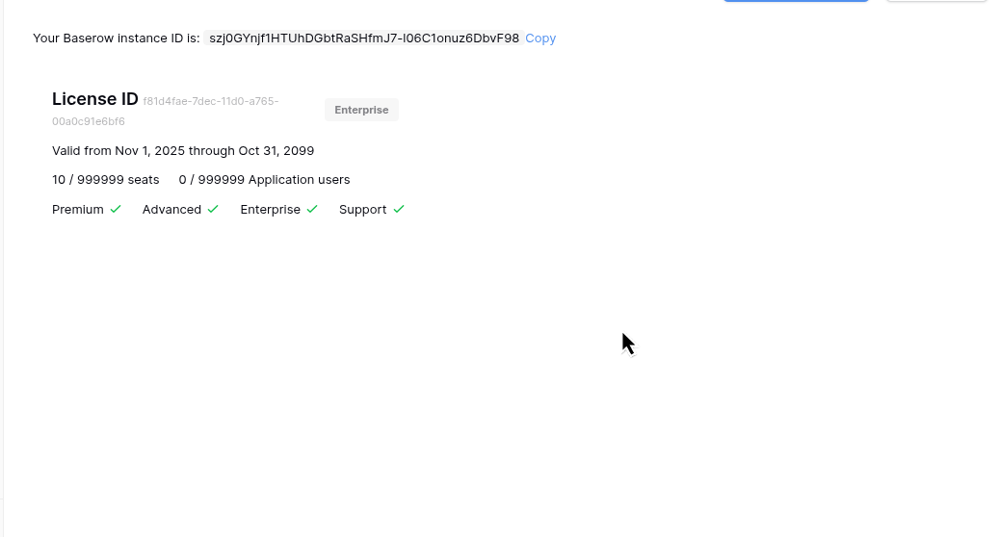
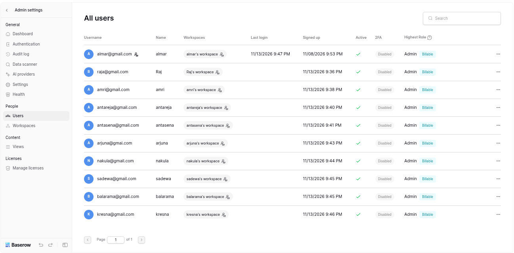
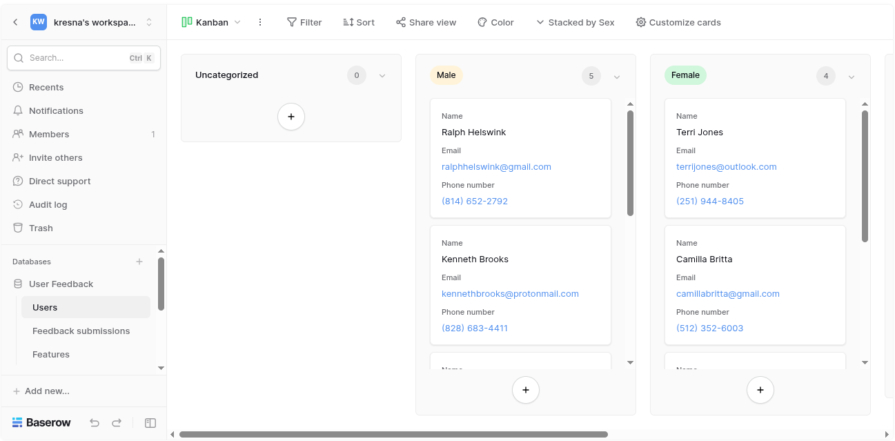

# BAS-8: Set license capacity to effectively unlimited, not five users
*CODE:DEV-891*

This state we focus to try our license result, especially for sharing

## License Payload
One thing that should be remember, we have been using `999999` allowance. With this, we will be definitely have enough user to use 1 license.

>**CAVEAT**: It's obvious that we should only use it in lab-only value because `999999` seats

To verify `999999`:
```bash
# after create license
python verify.py
```


## License Sharing

### User List
For this, we have created 10 users with enterprise features



### Late-User Premium Test
Just showing that they do really have enterprise mode



## Exceed Capacity
If you read `handler.py`, you may see `add_user_to_license()` function. That function literally focus on add user to certain license and it will give `NoSeatsLeftInLicenseError` if no seats left because it using this check `seats_taken >= license_object.seats`

Meanwhile, for application users, `ApplicationUserUsageHandler` in `application_user_usage` sums active users from published applications and compares that count against `application_users` instead of `DEFAULT_APPLICATION_USERS_LIMIT = 500`. With `999999`, there is no separate per-user limit, no integer overflow, and no extra query overhead.

## Confirmation for Long-Run Test (`BAS-9`)

**Confirmed:** The seat allowance and application-user allowance (`999999`) are permanently settled and do not need to be revisited for the long-run test in `BAS-9`.